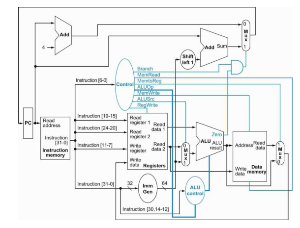

# Single-Cycle RISC-V Processor

A SystemVerilog implementation of a single-cycle RISC-V processor, developed using Vivado. The project explores the fundamental components of a CPU datapath, instruction decoding, ALU operations, memory access, and control-signal generation.

## Overview

This project implements a processor organized around a single-cycle datapath. Each instruction follows the fetch, decode, execute, memory-access, and write-back sequence within one instruction cycle.

The design includes dedicated modules for the program counter, instruction memory, register file, arithmetic logic unit (ALU), immediate generation, control logic, data memory, and datapath multiplexers.

## Processor Architecture

The processor's major components work together as follows:

1. **Instruction Fetch:** The program counter (PC) provides the address used to retrieve an instruction from instruction memory.
2. **Instruction Decode:** The control unit examines the instruction opcode and generates control signals for the datapath.
3. **Execute:** The ALU performs arithmetic, logical, or comparison operations. Immediate-generation logic supplies the immediate operand when required.
4. **Memory Access:** Load and store instructions use the data-memory interface to read or write data.
5. **Write-Back:** Multiplexing logic selects the appropriate result, such as an ALU result or memory data, for writing into the register file.
6. **Next-PC Selection:** PC-related logic and branch-control signals support sequential execution and branch-related address selection.

## Datapath

The processor datapath integrates the execution and control components to coordinate instruction processing.



The datapath includes the program counter, instruction and data memories, register file, ALU, immediate generator, control unit, and multiplexers for selecting operands, results, and next-PC values.

## Instruction Classes

The control unit decodes the following opcode classes:

| Instruction class | Opcode | Purpose |
|---|---|---|
| R-type | `0110011` | Register-to-register ALU operations |
| I-type arithmetic | `0010011` | Immediate-based ALU operations |
| Load | `0000011` | Read data from memory |
| Store | `0100011` | Write data to memory |
| Branch | `1100011` | Branch-related comparison and control |

The exact supported instruction mnemonics depend on the implementation of the ALU-control logic, immediate generator, branch comparison, and datapath. These should be checked against the RTL before claiming complete RV32I instruction-set support.

## Main RTL Modules

| Module | Responsibility |
|---|---|
| `top.sv` | Integrates the processor components |
| `Program_Counter.sv` | Holds the current instruction address |
| `PC_adder.sv` | Computes a program-counter-related address |
| `inst_mem.sv` | Provides instruction memory |
| `control_logic.sv` | Generates control signals from the opcode |
| `reg_file.sv` | Implements the register file |
| `alu.sv` | Performs arithmetic and logical operations |
| `alu_logic.sv` | Supports ALU operation decoding |
| `imm_gen.sv` | Generates instruction immediate values |
| `Data_memory.sv` | Implements the data-memory interface |
| `ALU_adder.sv` | Provides adder logic |
| `and_logic_branch.sv` | Supports branch-control logic |
| `mux_ALUsrc.sv` | Selects the ALU's second operand |
| `Mux2_PC.sv` | Selects a program-counter input |
| `Mux3_Memory.sv` | Selects a result for the relevant datapath path |

## Simulation

The repository includes a processor-level testbench at `Simulation/tb_top.sv`.

The testbench:
- Generates a clock with a 10 ns period.
- Holds reset active for the initial 10 ns.
- Deasserts reset and allows the processor to run.
- Generates a VCD waveform dump named `tb.vcd`.

### Running the simulation

1. Open the project in **Xilinx Vivado**.
2. Add the SystemVerilog RTL files to the design sources.
3. Add `Simulation/tb_top.sv` as a simulation source.
4. Set `tb_top` as the simulation top module.
5. Run behavioral simulation and inspect the waveforms to observe processor activity.

**Verification note:** The provided testbench does not include self-checking assertions or comparisons against expected register and memory values. Therefore, a completed simulation alone does not establish that all instructions execute correctly.

## Repository Structure

```text
RISC-V-Single-Cycle-Processor/
├── RTL/
│   ├── ALU_adder.sv
│   ├── Data_memory.sv
│   ├── Mux2_PC.sv
│   ├── Mux3_Memory.sv
│   ├── PC_adder.sv
│   ├── Program_Counter.sv
│   ├── alu.sv
│   ├── alu_logic.sv
│   ├── and_logic_branch.sv
│   ├── control_logic.sv
│   ├── imm_gen.sv
│   ├── inst_mem.sv
│   ├── mux_ALUsrc.sv
│   ├── reg_file.sv
│   └── top.sv
├── Simulation/
│   └── tb_top.sv
├── docs/
│   └── Single_Cycle_data_path.png
└── README.md
```

## Tools and Technologies

- SystemVerilog
- Xilinx Vivado
- RTL design and simulation


[GitHub Profile](https://github.com/Sidra642)
